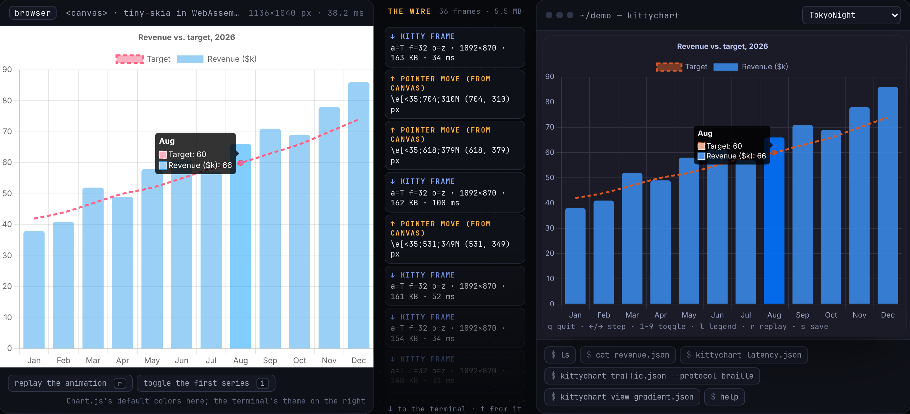
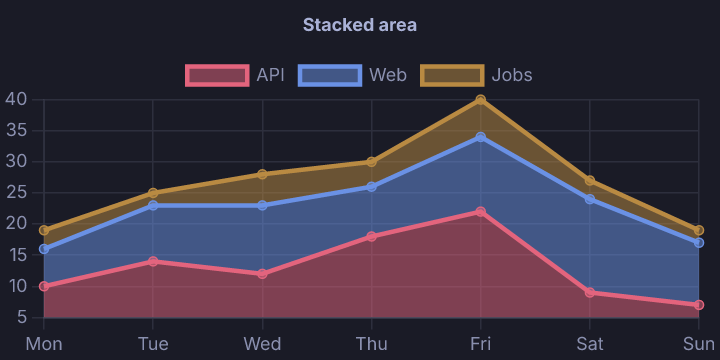
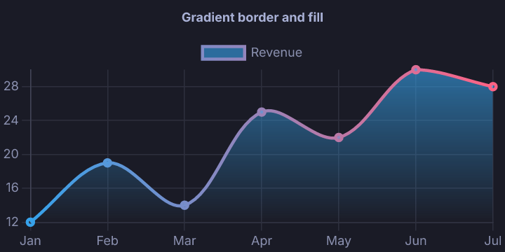
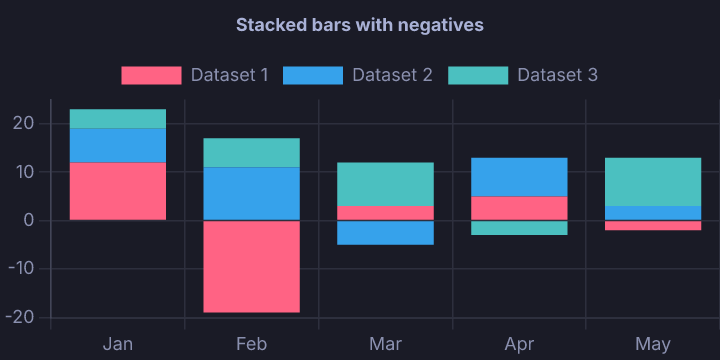
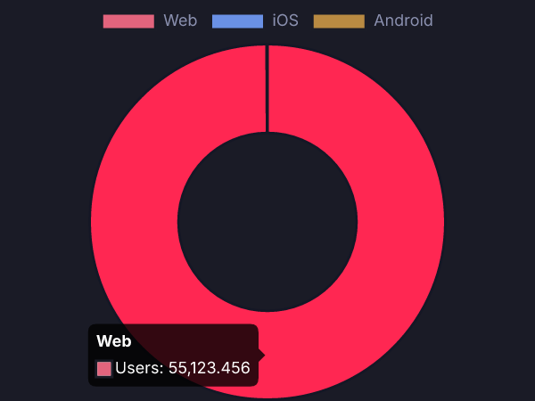
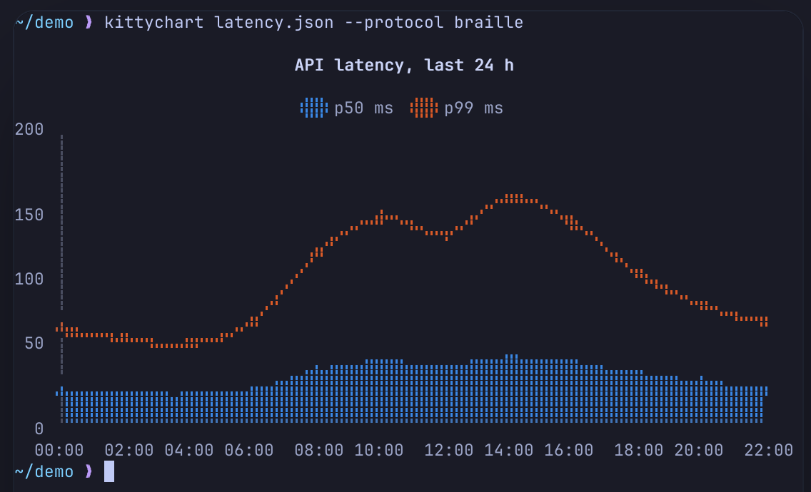

# KittyChart

[](https://github.com/CoreyKaylor/KittyChart/actions/workflows/ci.yml)
[](#license)

Chart.js charts in your terminal. KittyChart is a Rust port of Chart.js: give it a Chart.js
config (`{ type, data, options }`) and it draws the chart in the terminal, or renders it to PNG
or SVG. It has bindings for Python, Node.js (also Bun and Deno) and C, plus a ratatui widget.

[](https://coreykaylor.github.io/KittyChart/)

**[Live demo](https://coreykaylor.github.io/KittyChart/)**: KittyChart compiled to WebAssembly,
drawing into a browser canvas and into a real terminal emulator side by side.

## Features

- **Chart types:** line, bar (grouped, stacked, floating, horizontal), scatter, bubble, pie,
  doughnut, radar, polar area, and mixed charts.
- **Scales:** category, linear, logarithmic, time, timeseries and radial.
- **Plugins:** title, subtitle, legend, tooltip, filler (area fills), decimation and colors.
- **Chart.js options:** defaults, option cascading, scriptable options, gradients and line
  segment styles.
- **Terminal output:** kitty graphics (direct or Unicode placeholders, so it works in tmux),
  sixel, or block and Braille text when the terminal has no graphics. The protocol is detected
  automatically.
- **Theme colors:** default colors come from your terminal's theme.
- **Interactive viewer:** hover tooltips, legend toggles, keyboard navigation, animations, and
  live reload when the file changes.
- **Files:** PNG and SVG, with fonts built in. No browser, Node or system fonts needed.

| Output | Terminals |
|---|---|
| kitty graphics | kitty, Ghostty, WezTerm, Konsole, and tmux with `allow-passthrough on` |
| sixel | foot, xterm, mlterm, Windows Terminal |
| block and Braille text | any terminal |

## Install

```sh
pip install kittychart          # Python
npm install kittychart          # Node.js, Bun, Deno
cargo install kittychart-cli    # the `kittychart` command
cargo add kittychart            # Rust library
```

Prebuilt CLI and C library archives for Linux, macOS and Windows are attached to each
[release](https://github.com/CoreyKaylor/KittyChart/releases).

## Quick start

### Command line

```sh
kittychart chart.json                     # draw at the cursor
kittychart view chart.json --watch        # full-screen and interactive; follows the file
kittychart chart.json --out chart.png     # or chart.svg
cat chart.json | kittychart --protocol braille --cols 80
```

### Python

```python
import kittychart

chart = kittychart.Chart(
    type="line",
    data={
        "labels": ["Mon", "Tue", "Wed", "Thu", "Fri"],
        "datasets": [{"label": "Requests", "data": [120, 190, 170, 250, 210], "fill": True}],
    },
)
chart.show()                  # draw at the cursor
chart.interact()              # explore it full-screen
chart.save("chart.png")       # or .svg
```

numpy arrays, pandas and polars data go straight into `data`, and charts work in Rich,
Textual and Jupyter. See the [Python docs](bindings/python/README.md).

### Node.js

```js
const { Chart } = require('kittychart')

new Chart({
  type: 'bar',
  data: { labels: ['Q1', 'Q2', 'Q3', 'Q4'], datasets: [{ label: 'Revenue', data: [12, 19, 7, 15] }] },
}).show()
```

The typings accept Chart.js's own `ChartConfiguration`, so existing configs carry over. See the
[Node docs](bindings/node/README.md).

### Rust

```rust
use kittychart::{ChartConfig, show::{show, ShowOptions}};

let config = ChartConfig::from_json(r#"{
    "type": "bar",
    "data": { "labels": ["Q1", "Q2", "Q3"], "datasets": [{ "label": "Revenue", "data": [12, 19, 7] }] }
}"#)?;
show(config.clone(), &ShowOptions::default())?;                         // draw at the cursor
let png = kittychart::render(config, &kittychart::RenderOptions::new(800.0)).to_png();
```

`kittychart-ratatui` provides a widget for ratatui apps, with hover and tooltips.

### C

A C ABI with a generated header (`include/kittychart.h`): see the [C docs](docs/c.md).

## Examples

| | |
|---|---|
|  |  |
|  |  |

Without terminal graphics, the same config draws as text: regions become block characters and
lines become Braille.



The [gallery](docs/gallery.md) shows every test chart, both with Chart.js's colors on a white
page and with theme colors in a dark terminal.

## Interactive viewer

`kittychart view chart.json`, `chart.interact()` in Python and `interact()` in Node open the
chart full-screen:

| Key | |
|---|---|
| mouse | hover for tooltips; click legend items to toggle them |
| `←` `→` `Home` `End` | step through the data points |
| `1`–`9` | toggle a dataset (a slice on pie, doughnut and polar charts) |
| `l` | show or hide the legend |
| `r` | replay the animation |
| `s` | save a PNG |
| `q`, `Esc` | quit |

## Documentation

- [Overview and CLI reference](docs/index.md)
- [Python](bindings/python/README.md), [Node.js](bindings/node/README.md), [C](docs/c.md)
- [Gallery](docs/gallery.md)

## Workspace

| Crate | Purpose |
|---|---|
| `kittychart` | The library: `render` to RGBA, PNG or SVG; `show` detects the terminal and draws |
| `kittychart-core` | The Chart.js port: config, options, scales, layout, controllers, plugins |
| `kittychart-canvas` | Canvas2D-style drawing on tiny-skia, with cosmic-text and bundled Inter |
| `kittychart-term` | kitty and sixel encoders, capability detection, mouse and key input parser |
| `kittychart-cli` | The `kittychart` command |
| `kittychart-ratatui` | ratatui widget |
| `kittychart-ffi` | C ABI and header |
| `kittychart-wasm` | WebAssembly build used by the demo site |
| `bindings/python`, `bindings/node` | Python (PyO3) and Node (napi-rs) packages |

## Development

```sh
mise install        # pinned toolchain: zig, just, nextest, node, uv, mdbook
just test           # unit, golden image and protocol tests
just test-all       # + conformance against Ghostty's VT core, libsixel and tmux, and end-to-end runs
just test-bindings  # Python and Node tests
just ci             # everything CI runs
just parity         # compare every fixture against Chart.js 4.6.1 in headless Chromium
just preview FILE   # screenshot charts inside simulated terminals across themes
just web-serve      # build the demo site and docs, then serve them on 127.0.0.1:8766
```

Golden fixtures are Chart.js configs in `tests/fixtures/`. Each one is checked against
`tests/goldens/` and scored against real Chart.js output by `just parity`.

## License

MIT OR Apache-2.0
